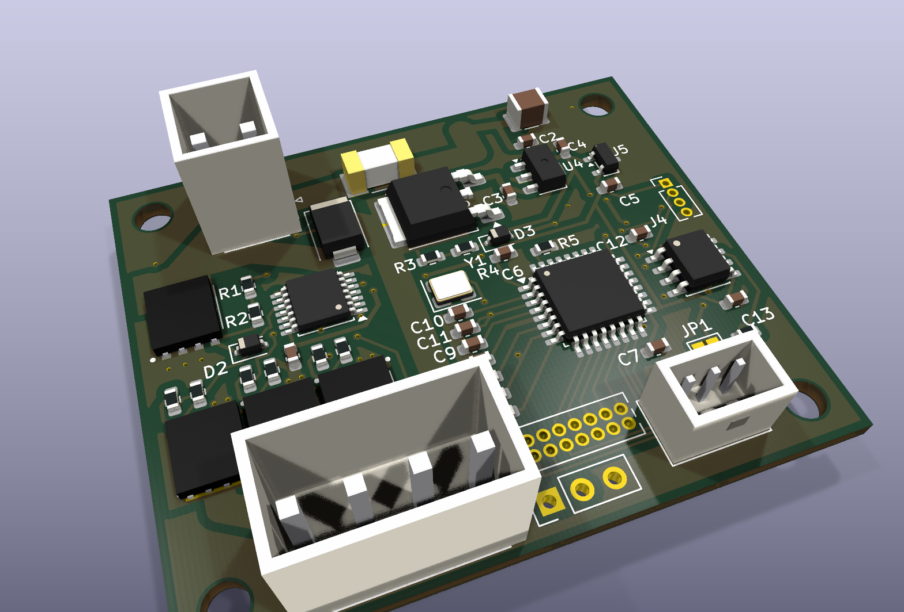
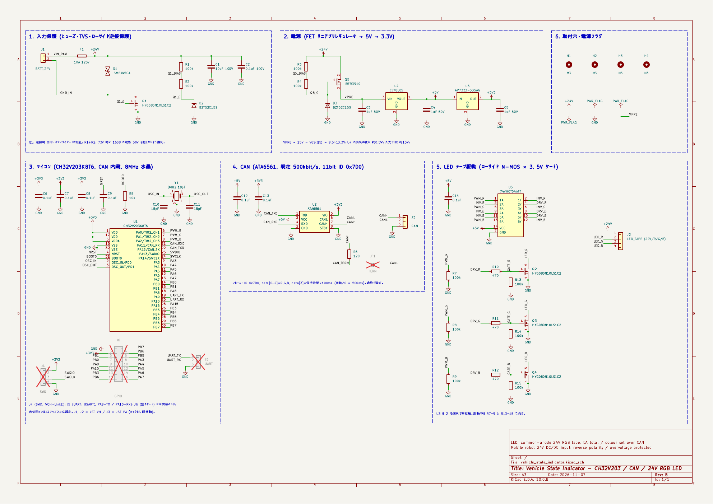
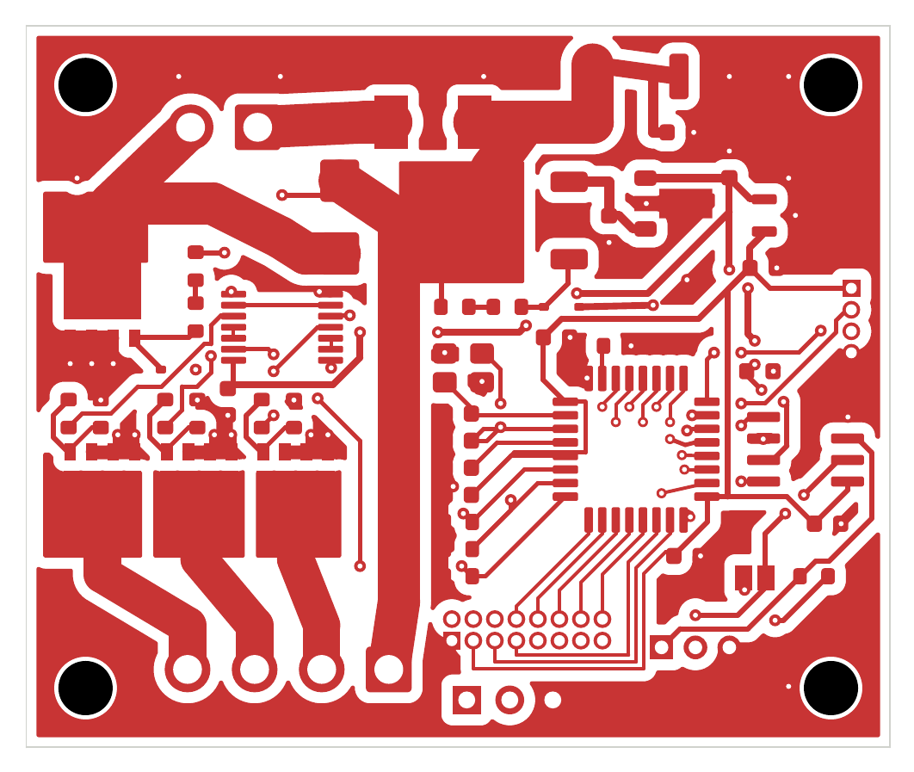
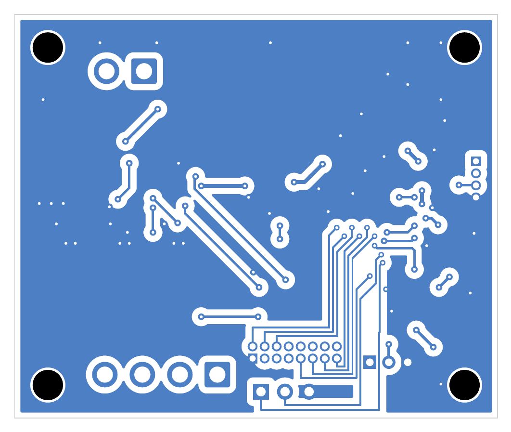
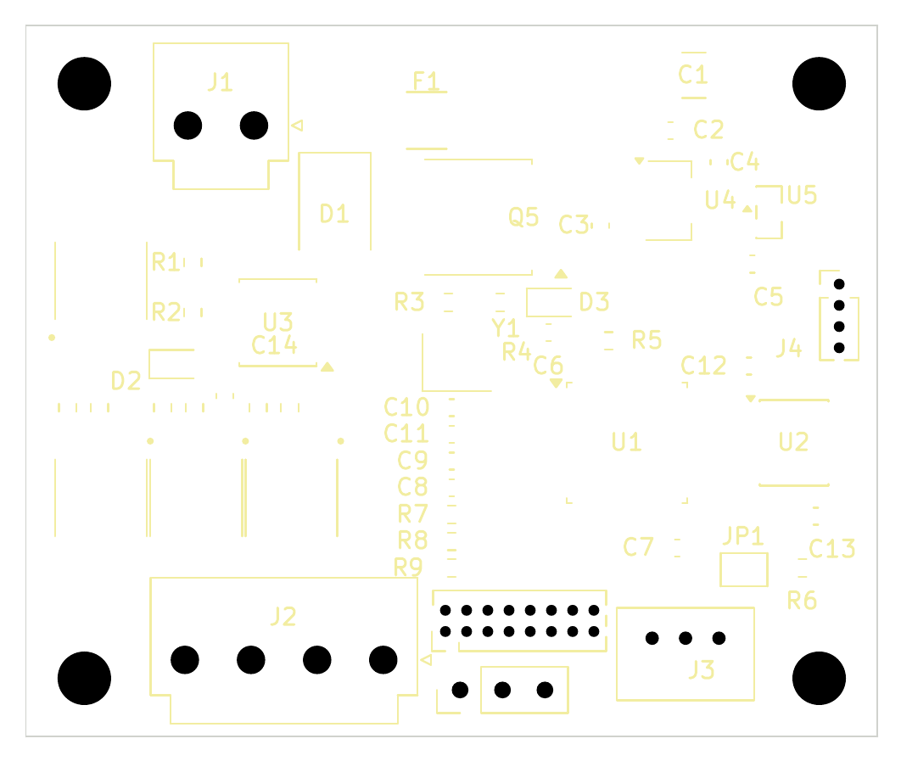
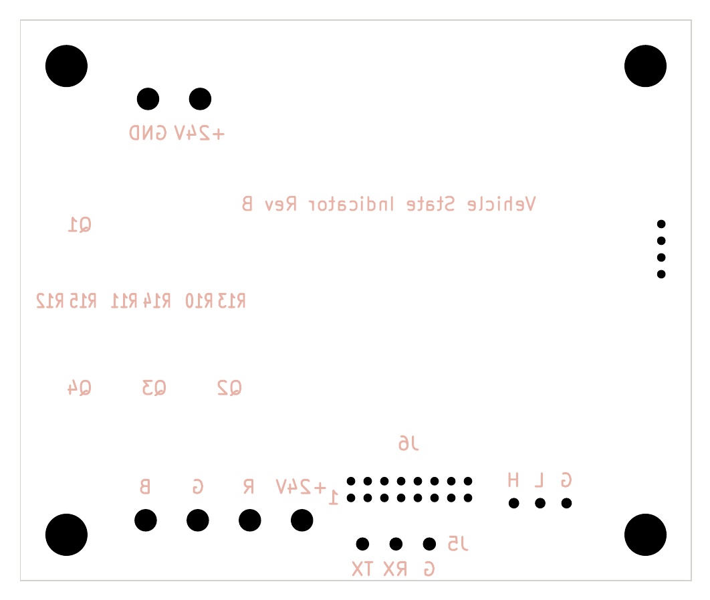
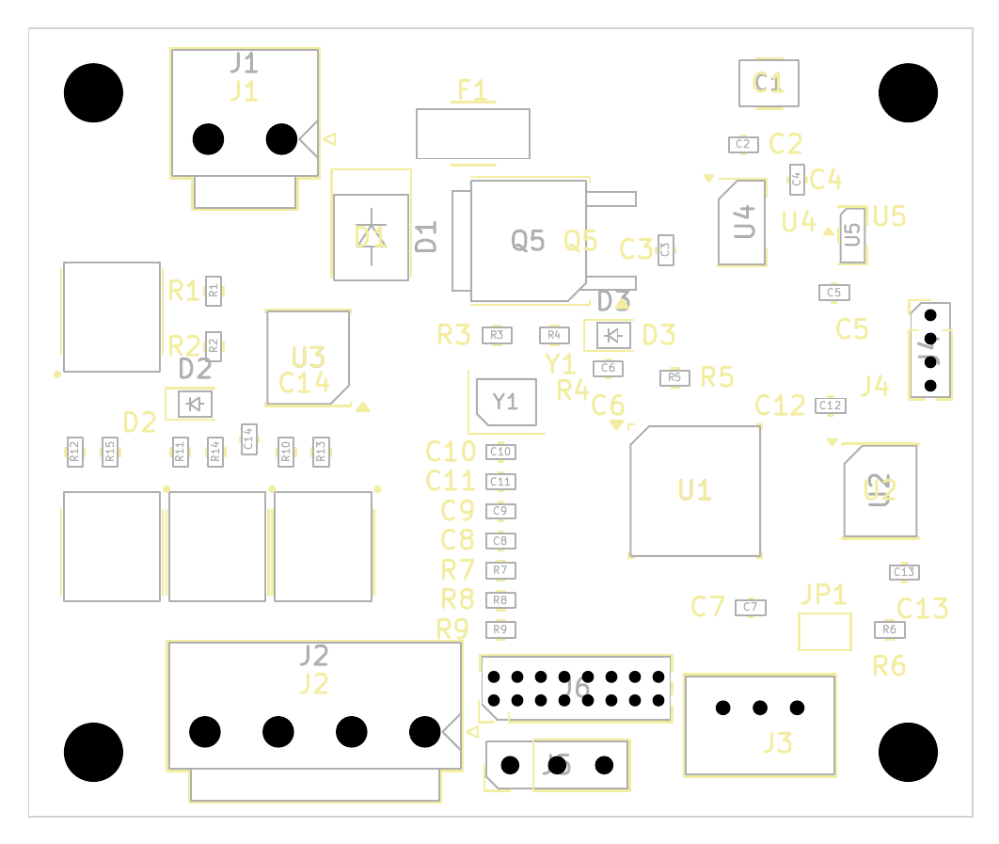
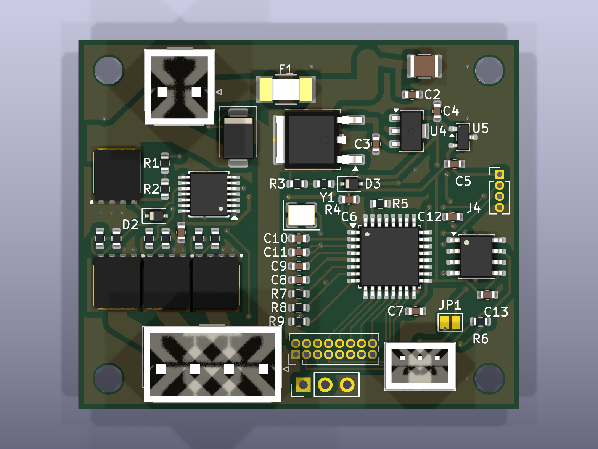
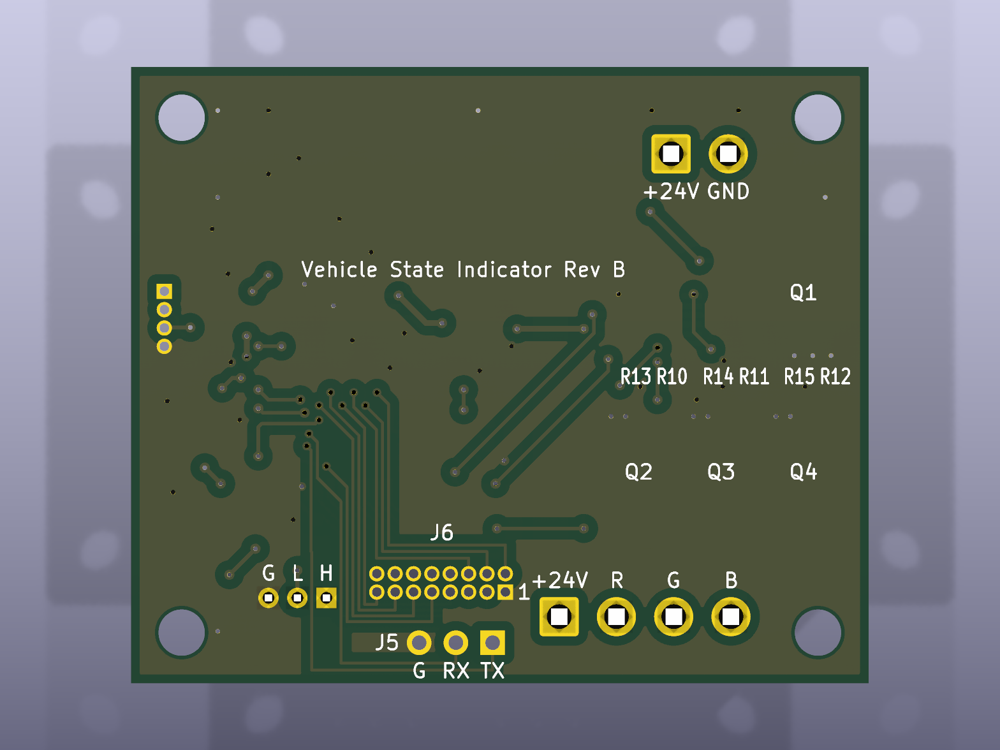

# RGB LED Controller

移動ロボットに載せる状態表示基板。CAN で受けた色を 24V コモンアノード RGB LED テープに出す。
マイコンは CH32V203K8T6、電源は 24V から生成する。

**状態: Rev B の設計完了。JLCPCB の部品実装向けにデータ作成済み (ERC/DRC 違反 0、未接続 0、回路図と基板の不一致 0)。発注、実機確認は未実施。**



要求、前提、未解決事項は [docs/requirements.md](docs/requirements.md)、設計判断は [docs/adr/](docs/adr/) で管理しています。

## ディレクトリ構成

```
docs/requirements.md   要求、設計上の前提、未解決事項
docs/adr/              設計判断の記録
firmware/              CH32V203 ファームウェア
hardware/              KiCad プロジェクト
├── docs/              README 掲載の画像
└── fabrication/       ガーバー、BOM、部品座標、ハーネス部品
```

## 仕様

| 項目 | 値 |
|---|---|
| 入力電圧 | DC/DC コンバータの 24V 出力 (モータ駆動回路とは別電源)。回路の許容範囲は約 13〜45V |
| 入力保護 | ヒューズ 10A (Littelfuse 0451010.MRL、表面実装)、TVS SMBJ45CA (クランプ最大 72.7V)、ローサイド N-FET 逆接保護 |
| 電源 | Q5 IRFR3910 (FET リニアプリレギュレータ) → CJ78L05 (5V) → AP7333 (3.3V) |
| マイコン | CH32V203K8T6 (8MHz 水晶、PLL なし) |
| CAN | ATA6561。既定 500kbit/s、低優先の ID 0x7D0。終端 120Ω は JP1 をはんだでつなぐと有効 |
| LED 出力 | ローサイド N-MOS × 3 (HYG080N10LS1C2、100V、4.5V 駆動で最大 13mΩ)、合計 5A の想定、PWM 1kHz |
| 端子 | JST VH (電源、LED)、JST PA (CAN)。いずれもロック付き |
| 拡張用パッド (未実装) | SWD 書き込み (J4)、デバッグ用 UART (J5)、空きポート 14 本 (J6) |
| 基板 | 51 × 42.6mm、2 層、厚さ 1.6mm、M3 取付穴 × 4 (四隅) |

## 回路図



PDF 版: [rgb_led_controller_schematic.pdf](hardware/rgb_led_controller_schematic.pdf)

## 接続

| 端子 | 型番 | ピン | 信号 |
|---|---|---|---|
| J1 | JST B2P-VH | 1 / 2 | +24V 入力 / GND 入力 |
| J2 | JST B4P-VH | 1 / 2 / 3 / 4 | +24V (共通) / R− / G− / B− |
| J3 | JST B03B-PASK | 1 / 2 / 3 | CANH / CANL / GND |
| J4 (未実装) | 1.27mm 4 ピン | 1 / 2 / 3 / 4 | +3.3V / SWDIO / SWCLK / GND (WCH-LinkE で書き込み) |
| J5 (未実装) | 2.54mm 3 ピン | 1 / 2 / 3 | UART TX (PA9) / RX (PA10) / GND (デバッグ用、USART1) |
| J6 (未実装) | 1.27mm 2 × 8 ピン | 下表 | 空きポート 14 本と +3.3V、GND |

J4〜J6 はパッドのみで、JLC では実装しません。使うときはピンヘッダを手はんだしてください。各端子の信号名は裏面シルクに記載しています (J6 は 1 番ピンの印のみ)。

J6 のピン配置 (選定理由は [ADR-0008](docs/adr/0008-io-breakout.md)):

| ピン | 信号 | ピン | 信号 |
|---|---|---|---|
| 1 | GND | 2 | PB7 |
| 3 | +3.3V | 4 | PB6 |
| 5 | PB1 | 6 | PB5 |
| 7 | PB0 | 8 | PA3 |
| 9 | PA8 | 10 | PA4 |
| 11 | PA15 | 12 | PA5 |
| 13 | PB3 | 14 | PA6 |
| 15 | PB4 | 16 | PA7 |

| 信号 | マイコンのピン | 機能 |
|---|---|---|
| R / G / B | PA0 / PA1 / PA2 | TIM2 CH1 / CH2 / CH3 |
| CAN RX / TX | PA11 / PA12 | CAN |
| SWDIO / SWCLK | PA13 / PA14 | 書き込み |
| UART TX / RX | PA9 / PA10 | USART1 (デバッグ用、ファームは未対応) |
| 空きポート | PA3〜PA8、PA15、PB0、PB1、PB3〜PB7 | J6。ファームではプルアップ入力 |

ハーネス側の部品は [harness_parts.csv](hardware/fabrication/harness_parts.csv) を参照してください。VH のコンタクトは AWG22〜18 に対応します。5A には AWG18 を使ってください。圧着工具が必要です。

## CAN フレーム

11bit 標準 ID `0x7D0`、500kbit/s (`firmware/src/main.c` の定義で変更可)。ID は番号が大きいほど低優先なので、他の制御フレームを妨げません。

| バイト | 内容 |
|---|---|
| data[0..2] | R, G, B (0〜255)。2 乗カーブで PWM に変換 |
| data[3] | 点灯時間 × 100ms (最大 25.5 秒)。0 または省略で 500ms |

DLC が 3 未満のフレームは無視します。**CAN が途絶えると、この時間の経過後に消灯します。** 点灯を続けるには、500ms より短い周期 (例: 100ms) で送り続けてください。既定の 500ms はビルド時に `COLOR_TIMEOUT_MS` で変更できます。

## 基板アートワーク

画像はすべて部品面から見た向きです (裏面シルクの文字は裏から読むので鏡文字です)。

| 表面銅箔 | 裏面銅箔 |
|---|---|
|  |  |

| 表面シルク | 裏面シルク |
|---|---|
|  |  |

### 部品配置



## 3D ビュー

| 表面 | 裏面 |
|---|---|
|  |  |

Q1〜Q4、F1、J1〜J3 の 3D モデルは自作の簡易形状です。J1、J2 の高さは推定値です。

## 発注

JLCPCB に基板製造と部品実装 (Economic PCBA、片面) を頼む前提です。部品はすべて LCSC (JLC の部品在庫) の品番で指定しています。部品の選定理由は [ADR-0007](docs/adr/0007-jlc-assembly.md) を参照してください。

| データ | ファイル |
|---|---|
| ガーバー、ドリル | [gerber.zip](hardware/fabrication/gerber.zip) |
| JLC 用部品表 (LCSC 品番) | [jlc_bom.csv](hardware/fabrication/jlc_bom.csv) |
| JLC 用部品座標 | [jlc_cpl.csv](hardware/fabrication/jlc_cpl.csv) |
| 部品表 (メーカー型番付き) | [bom.csv](hardware/fabrication/bom.csv) |
| 部品座標 (KiCad 形式) | [positions.csv](hardware/fabrication/positions.csv) |
| 電線側の部品 (秋月) | [harness_parts.csv](hardware/fabrication/harness_parts.csv) |

| 製造仕様 | 値 |
|---|---|
| 層数、板厚、銅厚 | 2 層、1.6mm、1oz 以上 |
| 最小配線幅、クリアランス | 0.2mm / 0.2mm (高電圧ネットは 0.6mm) |
| 最小穴径 | 0.3mm (ビア 0.7/0.3mm) |
| シルク文字 | 高さ 1.0mm 以上 |
| 実装 | 表面のみ。J1〜J3 は挿入部品 (JLC の手はんだ)。J4〜J6、JP1 は未実装 |

### 費用の見積り (5 枚、2026-11-07 時点)

JLC の部品検索と料金表から計算しました。$1 = ¥158 で換算しています。

| 費目 | 金額 |
|---|---|
| 部品 (LCSC、5 枚分 + JLC の予備分) | $31.9 |
| 拡張部品の追加料金 ($3.07 × 16 種類) | $49.1 |
| 実装の基本料 + ステンシル | $9.7 |
| はんだ付け (表面 790 点、挿入 45 点 + 手はんだ料) | $5.6 |
| 部品配置の確認 (任意) | $0.5 |
| **実装込みの小計** | **約 $97 (約 ¥15,300)** |
| 基板 5 枚 | 未確認 (JLC の即時見積りで確認) |
| 送料 | 未確認 (配送方法で変わる) |

追加料金は枚数によらず注文ごとにかかります。10 枚にすると実装込みで約 $121 (部品 $54.2) になり、1 枚あたりは下がります。

**発注前に確認してください。**

- ガーバーを JLC のビューアとルールチェックに通す。
- JLC のプレビューで部品の向きを確認する。KiCad の座標ファイルと JLC では、部品の回転の基準が違うことがある。
- 発注時の在庫を確認する。CH32V203K8T6 は在庫が少なめ (560 個)。
- 自作の J3 のフットプリントを現物と照合する。

## 検証結果

| 検証 | 結果 |
|---|---|
| ERC | 違反 0 (警告を含む) |
| DRC (警告を含む、カスタムルール込み) | 違反 0、未接続 0 |
| 回路図と基板の整合 | 不一致 0 |
| Q1〜Q4、F1 のランド | HYG080N10LS1C2 のパッケージ図、0451 系の推奨ランドと照合済み |
| ファームの PC テスト (`make test`) | 通過 |

実機の動作、温度、振動は未確認です。PlatformIO でのビルドと書き込みも未実行です。

配線幅は外層 1oz を前提に IPC-2221 で見積もると、5A 時の温度上昇は幅 2.5mm の電源配線で約 12°C、最も細い幅 2.2mm の LED 配線で約 15°C です。

## ファームウェア

```sh
cd firmware
make test            # PC 上で色の計算をテスト
make                 # riscv-none-elf-gcc でビルド
pio run -t upload    # WCH-LinkE で書き込み (未実行)
```
